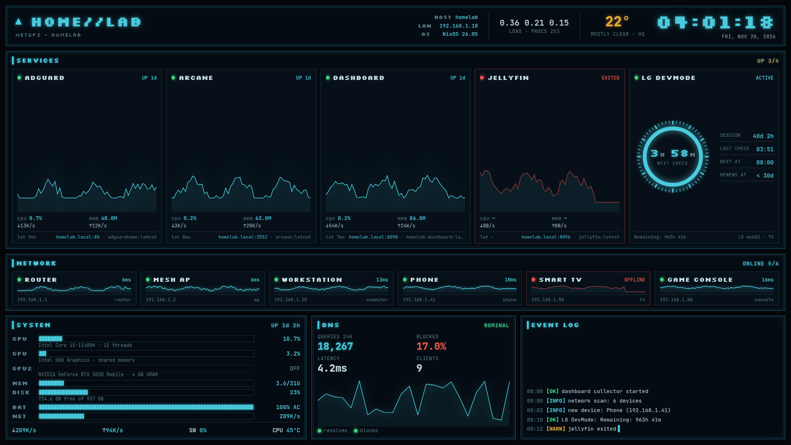
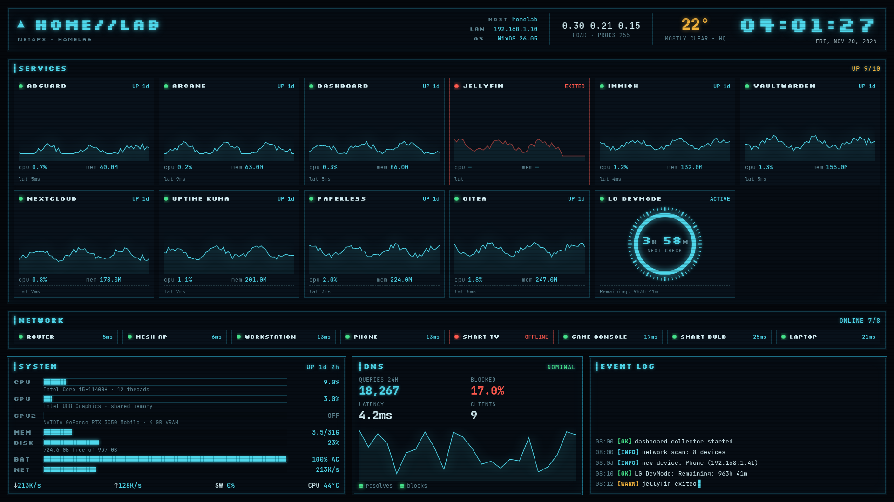
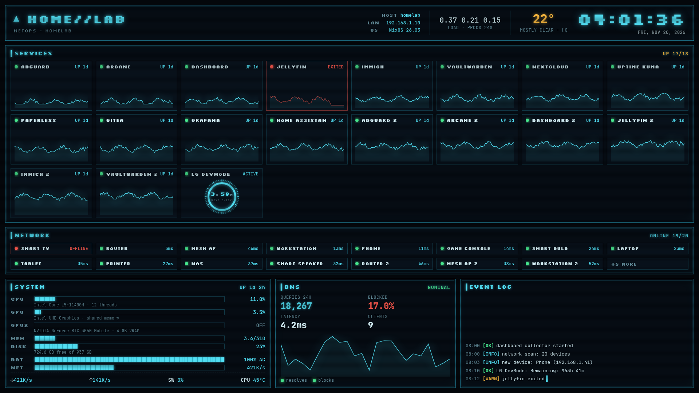
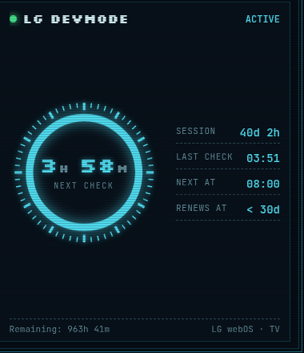
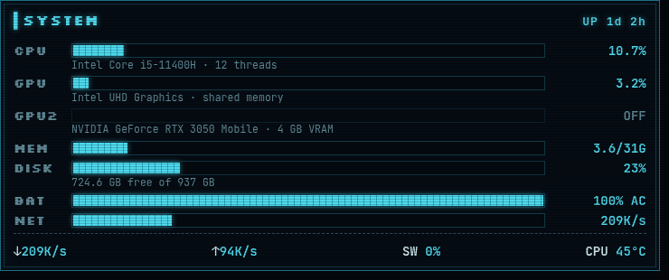
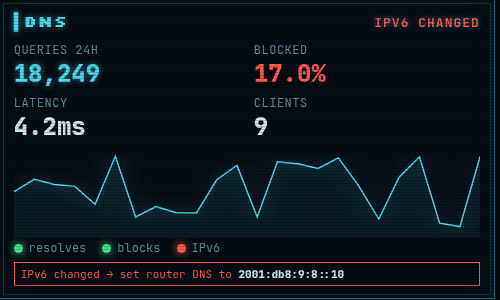

# HOME//LAB — terminal-style homelab dashboard

A retro, CRT-style status panel for a small homelab, built to run full screen on a kiosk
display (1920×1080) without keyboard or mouse. It shows your Docker containers, the devices on
your network, the host's hardware, AdGuard Home DNS stats and an event log. Everything updates
live and new containers or devices show up on their own.



- **Zero dependencies:** one Python file using only the standard library, plus a static HTML/CSS/JS page.
- **Data-driven:** no per-service configuration. Cards come from the Docker API and a network scan.
- **Kiosk friendly:** refreshes itself, keeps the last good data when something fails, never needs a click.

## Features

| Section | What it shows |
|---|---|
| **Header** | `BRAND//NAME`, host, LAN IP, OS, load average, process count, weather (optional) and a big clock |
| **Services** | One card per Docker container: status, uptime, CPU sparkline, CPU %, memory, network ↓↑, HTTP latency, a link to its web UI and the image tag. `UP n/m` turns amber when something is down |
| **Network** | One card per device on the LAN with ping latency. Devices are found by a periodic ping sweep plus the ARP table, and named from `names.json` or what they announce over mDNS (otherwise `Unknown Device`) |
| **System** | CPU (with model), each GPU (usage, model, VRAM or shared memory), memory, disk (free / total), battery, network |
| **DNS** | AdGuard Home queries, % blocked, latency, clients, 24 h chart, and live "resolves / blocks / IPv6" checks |
| **Event log** | Containers starting, stopping or disappearing, new devices, devices going offline, DNS degraded or recovered, periodic summaries |
| **Tasks** | Optional cards for scheduled jobs, drawn as a clock dial counting down to the next run (e.g. an LG webOS Developer Mode renewal timer), with the session time left and colour warnings |

### It adapts to how much you run

The layout picks the number of columns and the level of detail from the number of cards,
so it stays readable from 3 to 30+ services.

| 10 services | 18 services, 20 devices |
|---|---|
|  |  |

| Task card (next-check countdown) | System panel |
|---|---|
|  |  |

> All screenshots use fictional demo data (`mock.py`).

## How it works

```
                       ┌──────────────── collector.py (one container) ────────────────┐
 Docker API (socket:ro)│ every 3 s   containers, CPU/mem/net per container, host stats │
 /proc, /sys           │ every 10 s  HTTP latency per service, DNS checks, AdGuard API │──► /status.json
 ping, ip neigh, mDNS  │ every 30 s  ping known devices + ARP discovery                │      + web/
 Open-Meteo (optional) │ every 6 h   ping sweep of the LAN to find new devices         │        │
                       └───────────────────────────────────────────────────────────────┘        │
                                                                    browser / kiosk ◄── http://host:8090
```

The page (`web/`) fetches `/status.json` every 3 seconds and redraws.

## Quick start (Docker)

```bash
git clone https://github.com/YTvictorworld/homelab-dashboard.git
cd homelab-dashboard
cp examples/compose.example.yaml compose.yaml      # edit BRAND, NAME, TZ, HOST_NAME
cp .env.example .env && chmod 600 .env             # optional: AdGuard credentials
mkdir -p data && cp examples/names.example.json data/names.json
docker compose up -d --build
```

Open `http://<server>:8090`.

The container uses `network_mode: host` (so it can ping and read the ARP table of your real LAN) and
`pid: host` (to count host processes). Docker is mounted **read-only**: the dashboard only reads.

## Configuration

All settings are environment variables.

| Variable | Default | Meaning |
|---|---|---|
| `PORT`, `BIND` | `8090`, `0.0.0.0` | Web server |
| `BRAND`, `NAME`, `ROLE` | `HOME`, `LAB`, `NETOPS - homelab` | Header text (`BRAND//NAME`) |
| `HOST_NAME` | kernel hostname | Hostname shown in the header (useful inside a container) |
| `OS_RELEASE` | `/etc/os-release` | Mount the host's file to show the host OS instead of the container's |
| `HOST_IP`, `LAN_CIDR` | auto | Detected from the default route |
| `PUBLIC_HOST` | `<hostname>.local` | Host used to build the service links |
| `ADGUARD_URL`, `ADGUARD_USER`, `ADGUARD_PASSWORD` | `http://127.0.0.1:80` | AdGuard Home API (stats are skipped without credentials) |
| `DNS_SERVER` | `HOST_IP` | Server used for the "resolves / blocks" checks |
| `DNS_IPV6` | off | The host IPv6 address your router hands out as DNS (see below) |
| `WEATHER_LAT`, `WEATHER_LON`, `WEATHER_PLACE` | off | Weather from [Open-Meteo](https://open-meteo.com) (no API key) |
| `SYNC_INTERVAL` | `3s` | Containers and host stats |
| `LATENCY_INTERVAL` | `10s` | HTTP latency and DNS checks |
| `PING_INTERVAL` | `30s` | Ping known devices and ARP discovery |
| `SCAN_INTERVAL` | `6h` | Full ping sweep of the LAN |
| `WEATHER_INTERVAL` | `15m` | Weather refresh |
| `CLEANUP_AFTER` | `7d` | Forget devices not seen for this long (devices in `names.json` are never forgotten) |
| `SUMMARY_INTERVAL` | `5m` | "n/m services nominal" log line |

Durations accept `30s`, `5m`, `6h`, `7d`.

### Container labels

```yaml
labels:
  - homelab.name=Jellyfin                    # card title (default: container name)
  - homelab.port=8096                        # port for latency + link (default: first published port)
  - homelab.url=https://jellyfin.example.lan # link override
  - homelab.hide=true                        # hide the container
```

### Naming devices and services — `data/names.json`

Re-read every cycle, so no restart is needed. See [`examples/names.example.json`](examples/names.example.json).

```json
{
  "services": { "adguardhome": { "name": "AdGuard", "port": 80 } },
  "devices":  { "192.168.1.50": { "name": "Living room TV", "kind": "tv" } }
}
```

Devices listed here always appear, as `OFFLINE` when they don't answer.

### IPv6 DNS watch — `DNS_IPV6`

If your router advertises the server's IPv6 address as DNS (DHCPv6 / RA), that address is built from the
prefix your ISP assigns, and many ISPs change it now and then. When it changes, clients silently fall
back to whatever DNS they still have and stop being filtered.

Set `DNS_IPV6` to the address you entered in the router. The DNS panel then shows an **IPv6** light:

- **green**: the host still has that address and the DNS server answers on it;
- **red**: the address is gone. The panel title reads `IPV6 CHANGED`, a box shows the host's new stable
  IPv6 to copy into the router, and the event log records it.

Only stable addresses count; temporary privacy addresses are ignored. After updating the router, update
`DNS_IPV6` too and recreate the container. Try it with `MOCK_IPV6_CHANGED=1 python3 mock.py`.



### Task cards — `data/lgtv.json`

Any script can write this file to get a task card. The dial counts down to the next scheduled run
(every 4 h, see `CHECK_EVERY_H` in `web/app.js`); `remaining_s` is shown as the session time left and
turns the dial amber below 30 % and red below 10 % or when `status` is not `ok`:

```json
{ "status": "ok", "remaining_s": 3468424, "checked_at": 1795159515, "msg": "Remaining: 963h 27m" }
```

It was built for a timer that renews an LG webOS Developer Mode session, but works for anything
with a "time left": certificates, subscriptions, backups.

## Kiosk mode (NixOS)

[`examples/nixos/kiosk.nix`](examples/nixos/kiosk.nix) turns a laptop or mini PC into a wall display:

- [Cage](https://github.com/cage-kiosk/cage) (a minimal Wayland compositor) running Firefox in `--kiosk` mode;
- waits for the dashboard before starting, restarts on crash, survives `nixos-rebuild`;
- a laptop lid close does not suspend;
- screen off at 23:00 and on at 07:00 through `/sys/class/backlight/*/bl_power`.

## Development

Design with fake, moving data (no server needed):

```bash
MOCK_SERVICES=10 MOCK_DEVICES=8 python3 mock.py &
python3 -m http.server 8090 --directory web
```

Run the real collector on your workstation against a remote server over SSH (key-based login required):

```bash
SSH_TARGET=user@server.local BIND=127.0.0.1 ADGUARD_URL=http://server.local python3 collector.py
```

In SSH mode, host files are read over a persistent SSH connection and Docker through a socket
forwarded with `ssh -L`. Network scans run from your workstation, so it has to be on the same LAN.

## Security notes

- The Docker socket is mounted read-only, but anyone who can reach the dashboard can see your container
  list and LAN devices. Keep port 8090 inside your network.
- AdGuard credentials live in `.env` (git-ignored). Use `chmod 600`.
- `data/` (device names, MACs, state) is git-ignored.

## License

[MIT](LICENSE)
